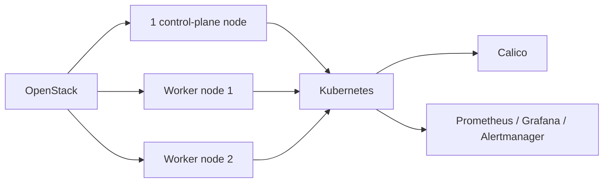

# Kubernetes Cluster Automation on OpenStack

Ansible automation for bootstrapping a small Kubernetes lab on OpenStack
instances. The playbooks install containerd and Kubernetes, initialize the
control plane, join workers, install Calico, and add Prometheus and Grafana.

## Current status

The repository contains the complete lab automation and monitoring manifests.
The November 2026 audit validated the YAML structure and removed committed SMTP
credentials. A fresh end-to-end run against OpenStack and Kubernetes was not
performed, so inventory addresses, operating-system compatibility, and cluster
state must be checked before execution.

## Architecture



## Repository layout

- `site.yml`: main orchestration entry point;
- `playbooks/`: prerequisite, containerd, Kubernetes, Calico, join, workload,
  monitoring, and alerting steps;
- `inventory/hosts.ini`: Ansible inventory;
- `group_vars/`: shared and host-group variables;
- `manifests/`: monitoring and alerting templates;
- `k8s-heat.yaml`: supporting OpenStack Heat template;
- `deploy.sh`: environment-specific deployment helper.

## Prerequisites

- reachable Ubuntu instances on OpenStack;
- SSH key access from the Ansible controller;
- host keys verified in the controller's `known_hosts` file;
- Python on the managed nodes;
- Ansible on the controller;
- inventory addresses and variables reviewed for the target environment.

## Run the automation

Review `inventory/hosts.ini`, `group_vars/`, and every playbook that affects an
existing cluster. Then run:

```bash
ansible-playbook -i inventory/hosts.ini site.yml
```

The repository also includes `deploy.sh`, which prepares environment-specific
inventory data. Read it before execution because it is tailored to the original
OpenStack lab.

The Heat template defaults to the original lab administration network
`192.168.1.0/24` for SSH, the Kubernetes API, ICMP, and NodePorts. Override
`admin_cidr` and `nodeport_cidr` for another environment; do not widen these
values to `0.0.0.0/0`. The helper writes its generated inventory to
`inventory/generated-hosts.ini`, which is intentionally ignored by Git.

## Alertmanager email configuration

Email credentials are read from the Ansible controller and are never expected in
Git:

```bash
export ALERTMANAGER_SMTP_FROM='sender@example.org'
export ALERTMANAGER_SMTP_USERNAME='sender@example.org'
export ALERTMANAGER_SMTP_PASSWORD='app-password'
export ALERTMANAGER_SMTP_TO='recipient@example.org'

ansible-playbook -i inventory/hosts.ini playbooks/13-alertmanager-email.yml
```

The playbook refuses to continue when a value is missing, renders a temporary
file with mode `0600`, applies the Kubernetes Secret, and removes the file.

## Validation

Run syntax checks before targeting a cluster:

```bash
ansible-playbook --syntax-check -i inventory/hosts.ini site.yml
ansible-playbook --syntax-check -i inventory/hosts.ini playbooks/13-alertmanager-email.yml
```

After deployment:

```bash
kubectl get nodes
kubectl get pods --all-namespaces
kubectl get svc -n monitoring
```

## Security notes

An SMTP credential was present in earlier Git history and must be considered
compromised. Removing it from the current branch does not revoke it; rotate that
credential with the email provider. Keep inventories, private keys, kubeconfigs,
and generated secrets outside the repository.

This automation targets a learning environment. Review network exposure,
Kubernetes versions, idempotency, and upgrade behavior before adapting it to a
shared or production cluster.
