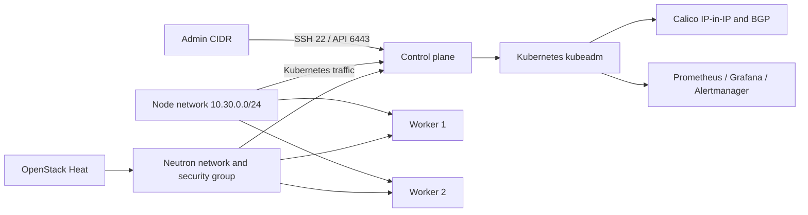

# Kubernetes Cluster Automation on OpenStack

Ansible automation for provisioning a small Kubernetes learning cluster on
OpenStack. The project covers the infrastructure layer, Kubernetes bootstrap,
Calico networking, a monitoring stack, and optional Alertmanager SMTP setup.

## Status and scope

The `k8s-cluster-hardening` branch has a green GitHub Actions static-validation
workflow. The workflow validates YAML, Ansible syntax, Alertmanager template
rendering, ShellCheck, and secrets in the current tree and commits added to the
branch.

This repository has **not** been validated by a fresh end-to-end OpenStack or
Kubernetes deployment. The current documentation and code must therefore be
treated as a reviewed lab automation baseline, not as proof of a production
deployment.

The SMTP credential exposed in earlier Git history remains compromised until
the account owner confirms its revocation and replacement. No real credential
is stored in the current tree, and no credential is required by the CI.

## Architecture



The Heat template creates one control-plane node and two workers on an
internal `10.30.0.0/24` network, with floating IPs for the lab workflow.
Calico node traffic is restricted to the internal network. The security group
also limits SSH, the API, ICMP, and NodePorts to explicit CIDRs.

## Components

| Layer | Implementation | Repository status |
|---|---|---|
| Infrastructure | OpenStack Heat, Neutron, Nova, floating IPs | Template reviewed; stack not recreated in this audit |
| Configuration | Ansible Core | CI syntax validated; remote execution not run |
| Runtime | containerd with systemd cgroups | Runtime package is currently distro-managed and not pinned |
| Kubernetes | kubeadm, kubelet, kubectl | Current playbook targets the legacy `v1.29` repository |
| CNI | Calico `v3.27.0` manifest | Version is pinned in the URL; upgrade is not applied |
| Monitoring | Helm and kube-prometheus-stack | Chart and Helm versions are not pinned in the current playbook |
| Alerting | Prometheus Operator Alertmanager Secret | SMTP values come from controller environment variables |

The proposed maintained compatibility target is documented in
[`docs/compatibility-matrix.md`](docs/compatibility-matrix.md). It is a plan for
the next tested upgrade, not an assertion that the current lab has already been
upgraded.

## Repository layout

- `k8s-heat.yaml`: OpenStack Heat template and security group rules;
- `deploy.sh`: lab-specific stack creation, output collection, and inventory generation;
- `site.yml`: main Ansible orchestration entry point;
- `playbooks/01-prereqs.yml`: swap, kernel modules, and sysctl prerequisites;
- `playbooks/02-containerd.yml`: containerd installation and cgroup configuration;
- `playbooks/03-kubernetes.yml`: Kubernetes repository and package installation;
- `playbooks/04-init-master.yml`: standalone control-plane initialization;
- `playbooks/05-kubeconfig.yml`: restricted user kubeconfig distribution;
- `playbooks/06-cni-calico.yml`: standalone Calico installation;
- `playbooks/07-join-workers.yml`: standalone worker join;
- `playbooks/08-nginx.yml`: optional NodePort smoke workload;
- `playbooks/09-prometheus-grafana.yml`: monitoring stack installation;
- `playbooks/10-alerts.yml`, `11-ai-monitoring.yml`, `12-ai-alert.yml`: optional monitoring resources;
- `playbooks/13-alertmanager-email.yml`: optional SMTP configuration;
- `manifests/`: checked-in monitoring resources and the Alertmanager template;
- `.github/workflows/validate.yml`: static validation only;
- `inventory/hosts.ini`: example inventory; generated inventory is ignored by Git;
- `docs/compatibility-matrix.md`: version decision and upgrade gate.

## Prerequisites

- An OpenStack project with permission to create the Heat and Neutron resources;
- Ubuntu instances matching the Heat image and a reachable SSH key;
- Ansible installed on a Linux controller with the required Python version;
- verified SSH host keys in the controller `known_hosts` file;
- `openstack`, `nc`, `ansible`, and `ansible-playbook` available for `deploy.sh`;
- an inventory reviewed for the target environment;
- an explicit administration CIDR and NodePort CIDR;
- no real SMTP value in Git, shell history, or documentation.

## Installation workflow

### 1. Review the inputs

Review `k8s-heat.yaml`, `inventory/hosts.ini`, `ansible.cfg`, and the variables
used by the playbooks. The default lab CIDR is `192.168.1.0/24`; replace it for
the real administration network instead of widening it to `0.0.0.0/0`.

### 2. Create the OpenStack stack

The helper expects OpenStack credentials in `$HOME/admin-openrc` and accepts
environment overrides:

```bash
export ADMIN_CIDR='192.168.1.0/24'
export NODEPORT_CIDR='192.168.1.0/24'
export MAX_WAIT_SECONDS=900
export SSH_WAIT_SECONDS=600
./deploy.sh
```

`deploy.sh` polls Heat, waits for SSH, writes
`inventory/generated-hosts.ini`, and invokes Ansible with that generated
inventory. It does not run from GitHub Actions.

### 3. Run Ansible directly

For an already-created lab, review the inventory and run:

```bash
ansible-playbook --syntax-check -i inventory/hosts.ini site.yml
ansible-playbook -i inventory/hosts.ini site.yml
```

The main entry point installs prerequisites, containerd, Kubernetes, Calico,
the optional Nginx smoke workload, and the monitoring chart. The standalone
playbooks remain available for controlled, step-by-step execution.

## Alertmanager SMTP

SMTP configuration is deliberately separate from the main deployment. Supply
values only through the Ansible controller environment:

```bash
export ALERTMANAGER_SMTP_FROM='sender@example.invalid'
export ALERTMANAGER_SMTP_USERNAME='sender@example.invalid'
export ALERTMANAGER_SMTP_PASSWORD='use-a-provider-issued-app-password'
export ALERTMANAGER_SMTP_TO='recipient@example.invalid'

ansible-playbook -i inventory/hosts.ini playbooks/13-alertmanager-email.yml
```

The playbook refuses empty values, renders a temporary file with mode `0600`,
applies a generated Secret without putting the SMTP value in the client-side
apply annotation, removes the temporary file, and waits for Alertmanager.
Kubernetes Secret data is still base64 encoded rather than encrypted by this
playbook; encryption at rest must be configured at the cluster level.

Never paste a real address, password, app password, kubeconfig, private key, or
OpenStack credential into this README, an issue, or a commit.

## Validation

### CI validation

The workflow in `.github/workflows/validate.yml` runs on the
`k8s-cluster-hardening` branch and on pull requests targeting `main`. It performs
static checks only:

```text
YAML parsing
Ansible syntax checks
Alertmanager Jinja rendering with dummy values
ShellCheck
Gitleaks on the current checkout
Gitleaks on commits added relative to origin/main
```

It does not create OpenStack resources, access a Kubernetes API, publish an
image, deploy a chart, send email, or use real secrets.

### Local checks

```bash
python -m pip install ansible-core==2.17.14 pyyaml
ansible-playbook --syntax-check -i inventory/hosts.ini site.yml
ansible-playbook --syntax-check -i inventory/hosts.ini playbooks/13-alertmanager-email.yml
bash -n deploy.sh
shellcheck deploy.sh
```

After a real lab deployment, the following checks are still required:

```bash
kubectl get nodes -o wide
kubectl get pods --all-namespaces
kubectl get pods -n kube-system -l k8s-app=calico-node
kubectl get svc -n monitoring
helm list --all-namespaces
```

These runtime checks have not been executed for the current branch.

## Security and recovery

- SSH is restricted by `admin_cidr`.
- Kubernetes API access is restricted to `admin_cidr` and the internal node network.
- etcd, kubelet, Calico IP-in-IP, and Calico BGP are restricted to `10.30.0.0/24`.
- NodePorts are restricted by `nodeport_cidr`.
- The user kubeconfig is written with mode `0600`.
- Join commands and kubeadm output are hidden from Ansible logs.
- SMTP values are read from controller environment variables and are not committed.
- The old SMTP credential is not considered safe until the account owner confirms rotation.

If a stack must be removed after an approved lab test, use the matching stack
name and review the command before running it:

```bash
openstack stack delete --yes k8s-cluster
rm -f inventory/generated-hosts.ini
```

Deleting the Heat stack removes the OpenStack resources managed by that stack.
It does not revoke SMTP credentials, remove Git history, or delete resources
created manually outside Heat.

## Current limitations

- No fresh OpenStack stack was created during this audit.
- No kubeadm bootstrap, worker join, Calico readiness, or monitoring rollout was executed.
- Kubernetes `v1.29` is out of upstream support and must not be presented as a maintained production baseline.
- containerd is installed from the target distribution without an exact package pin.
- Helm is downloaded through an unpinned upstream installer script and the monitoring chart is not version-pinned.
- The small lab has one control-plane node and no tested high-availability or backup procedure.
- The generated inventory and kubeconfig are environment-specific and must remain outside commits.

## Portfolio summary

Verified technical work represented by this repository:

- OpenStack infrastructure provisioning with Heat and Neutron security groups;
- Ansible orchestration for containerd, kubeadm, worker joining, and kubeconfig handling;
- Kubernetes network hardening for Calico IP-in-IP and BGP node traffic;
- secret hygiene improvements for SMTP configuration and Ansible logging;
- bounded deployment waits and generated, ignored inventories;
- static CI gates for YAML, Ansible, ShellCheck, template rendering, and secrets.

These statements describe implemented automation and static validation only. They
do not claim a successful OpenStack or Kubernetes deployment.
