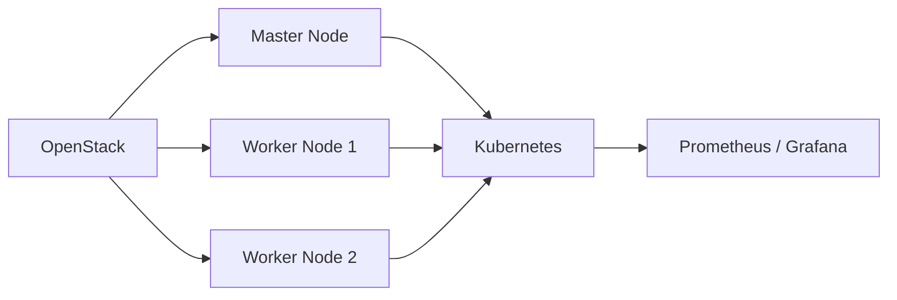

# Ansible Kubernetes Deployment on OpenStack

Automated solution for deploying a Kubernetes cluster on a private cloud using OpenStack and Ansible.

## Overview

This project provisions a cluster composed of:

- 1 master node
- 2 worker nodes

It also integrates a monitoring stack with Prometheus and Grafana for observability.

## Architecture

## Key Features

- Automated Kubernetes cluster deployment using Ansible roles
- Provisioning on OpenStack private cloud infrastructure
- Monitoring setup with Prometheus and Grafana
- Modular and reusable Ansible playbooks
- Ready environment for deploying containerized applications

## Repository Structure

- `site.yml` main Ansible entry point
- `playbooks/` task orchestration
- `group_vars/` environment-specific variables
- `inventory/` host inventory
- `manifests/` Kubernetes manifests
- `deploy.sh` deployment helper
- `k8s-heat.yaml` OpenStack Heat support file

## Usage

- Prepare the OpenStack environment and inventory
- Run the main Ansible playbook
- Validate cluster readiness
- Deploy workloads and monitoring

## Branching and Commits

- Use branches such as `feat/<area>`, `fix/<area>`, `docs/<area>`, or `infra/<area>`
- Keep commits tied to one automation change
- Prefer Conventional Commits such as `feat(ansible): add worker node bootstrap role`
- Avoid vague commit messages like `update`, `final`, or `test`

## Contributing

- Keep inventory and variable files clear and consistent
- Document any change that affects the cluster bootstrap process
- Avoid committing generated logs, credentials, or machine-specific files

---

---

## Technologies Used
- **Kubernetes** – Container orchestration  
- **Ansible** – Automation & configuration management  
- **OpenStack** – Private cloud infrastructure  
- **Docker** – Container runtime  
- **Prometheus** – Monitoring & metrics collection  
- **Grafana** – Data visualization and dashboards  

---

## Prerequisites
- OpenStack environment with running instances  
- SSH access to all nodes  
- Ansible installed on control machine  
- Python installed on remote nodes  
- Kubernetes dependencies (automated via Ansible roles)  

